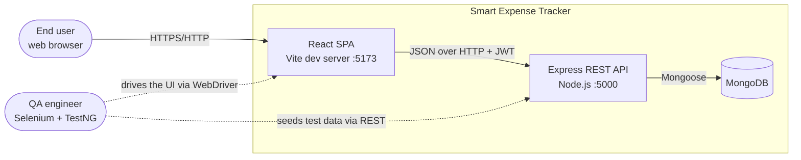
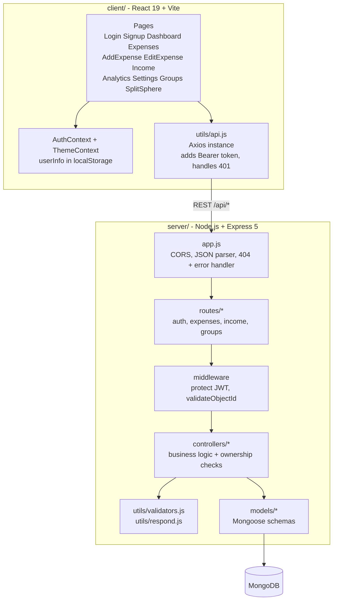
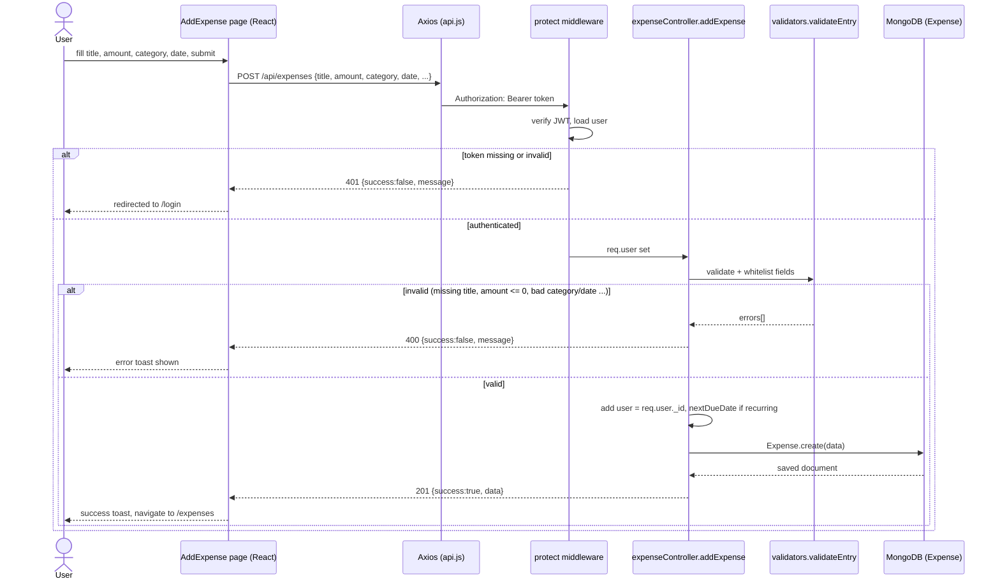
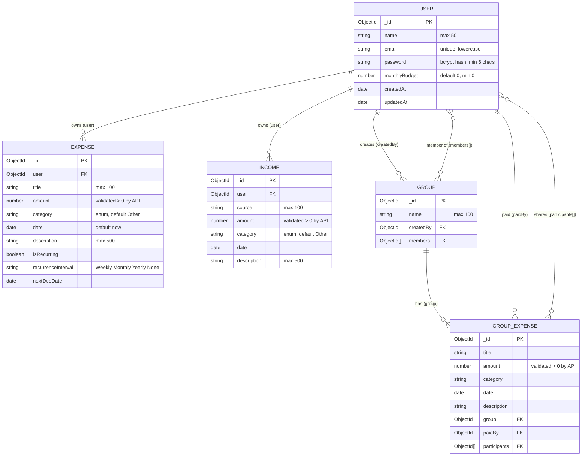

# System Design – Smart Expense Tracker

> Describes the application **as implemented in this repository** (React client + Express API + MongoDB).
> Diagram sources are editable Mermaid files in [`diagrams/`](diagrams/) and are embedded below.

## 1. Overview and scope
Smart Expense Tracker lets a registered user record expenses and income, set a monthly budget, view a
dashboard with charts and analytics, and split shared costs in groups ("SplitSphere").

**In scope:** registration/login (JWT), expense CRUD with filters and recurring expenses, income
create/list/delete, monthly budget, dashboard and analytics, groups with equal-split settlement summary,
CSV export of the (filtered) expense list (client side), light/dark theme.

**Out of scope / not implemented:** e-mail verification, password reset, refresh tokens, editing income in the UI,
a "mark settlement as paid" action in SplitSphere, multi-currency, bank imports, notifications.

## 2. Requirements
### Functional
| ID | Requirement |
|----|-------------|
| FR1 | A visitor can register (name, e-mail, password) and log in; duplicate e-mails are rejected |
| FR2 | A user can add, list, view, edit and delete their own expenses (title, amount, category, date, description, optional recurrence) |
| FR3 | Expenses can be filtered by category, date range, amount range and text search |
| FR4 | A user can add, list and delete income entries |
| FR5 | A user can set a monthly budget; the dashboard shows spend vs. budget |
| FR6 | Dashboard shows totals, balance, savings rate, charts and recent activity; Analytics shows month-over-month spending, top category and daily average |
| FR7 | A user can create groups, add registered users by e-mail, record shared expenses split equally among participants, and see who owes whom |
| FR8 | Recurring expenses generate their due occurrences when processed |
### Non-functional
| ID | Requirement | How it is addressed |
|----|-------------|---------------------|
| NFR1 | Security | bcrypt password hashing, JWT auth on all private routes, ownership checks, input validation, configurable CORS, no secrets in source |
| NFR2 | Data integrity | server-side validation (type, range, enum), whitelisting of writable fields, ObjectId validation, unique e-mail index |
| NFR3 | Usability | responsive React UI, toasts, loading/empty/error states, light/dark theme |
| NFR4 | Testability | `app.js` separated from `server.js`, pure validators, `data-testid` selectors, isolated test database |
| NFR5 | Maintainability | route → controller → model layering, shared validation module |
| NFR6 | Reliability | consistent JSON error format, no stack traces to clients, atomic claim of recurring occurrences |

## 3. Architecture and technology
| Layer | Technology | Responsibility |
|-------|-----------|----------------|
| Frontend | React 19, React Router 7, Vite 8, Axios, Bootstrap/React-Bootstrap, Chart.js, react-toastify, PapaParse (CSV export) | UI, client-side routing and guard (`ProtectedRoute`), form handling, charts, CSV/PDF export, token storage |
| Backend | Node.js, Express 5, Mongoose 9, jsonwebtoken, bcryptjs, cors, dotenv | REST API, authentication, authorization, validation, business rules (analytics, recurring, settlement) |
| Database | MongoDB | Persistence of users, expenses, income, groups and group expenses |
| Test tooling | Node `node:test`; Java 17 + Selenium + TestNG + Maven | backend tests; browser UI automation |

External dependencies: none at runtime besides MongoDB (no third-party APIs).

### System context

### High-level architecture


## 4. Component interaction and data flow
1. The SPA calls the API through one Axios instance (`client/src/utils/api.js`). `baseURL` comes from
   `VITE_API_URL` (default `http://localhost:5000/api`). A request interceptor adds `Authorization: Bearer <jwt>`;
   a response interceptor clears the session and redirects to `/login` on HTTP 401.
2. Express (`server/app.js`) applies CORS (origins from `CORS_ORIGIN`), parses JSON (100 kb limit) and mounts
   `/api/auth`, `/api/expenses`, `/api/income`, `/api/groups`. Unknown `/api/*` routes return JSON 404.
3. Private routers use the `protect` middleware, then `validateObjectId` for `:id` parameters, then a controller.
4. Controllers validate input with `utils/validators.js`, query Mongoose models filtered by the authenticated user
   (or group membership) and answer with `{ success, data | message }`.

## 5. API design
Base path `/api`. Private = requires `Authorization: Bearer <token>`.
| Method & path | Auth | Purpose | Success | Notable errors |
|---------------|------|---------|---------|----------------|
| `GET /health` | – | liveness | 200 | – |
| `POST /auth/register` | – | create account, returns user + token | 201 | 400 invalid input, 409 duplicate e-mail |
| `POST /auth/login` | – | log in | 200 | 400 missing/non-text input, 401 bad credentials |
| `GET /auth/me` | ✔ | current user | 200 | 401 |
| `PUT /auth/budget` | ✔ | set monthly budget (≥ 0) | 200 | 400 |
| `GET /expenses` | ✔ | list; query `category,startDate,endDate,minAmount,maxAmount,search` | 200 | 400 bad filter |
| `POST /expenses` | ✔ | create | 201 | 400 |
| `GET/PUT/DELETE /expenses/:id` | ✔ | owner-only read/update/delete | 200 | 400 bad id, 404 missing or not owner |
| `GET /expenses/analytics/summary` | ✔ | month totals, top category, average | 200 | – |
| `POST /expenses/process-recurring` | ✔ | create due recurring occurrences | 200 | – |
| `GET/POST /income`, `GET/PUT/DELETE /income/:id` | ✔ | income CRUD (owner-only) | 200/201 | 400, 404 |
| `GET/POST /groups` | ✔ | list own groups / create group | 200/201 | 400 |
| `GET /groups/:id` | ✔ | group + expenses (members only) | 200 | 403 not a member, 404 |
| `POST /groups/:id/members` | ✔ | add member by e-mail (members only) | 200 | 400 duplicate, 403, 404 unknown user |
| `POST /groups/:id/expenses` | ✔ | add shared expense; payer/participants must be members | 201 | 400, 403 |
| `GET /groups/:id/analytics` | ✔ | totals per member and settlement list | 200 | 403 |

Error format: `{ "success": false, "message": "...", "errors": ["..."] }` (`errors` only when several).
A missing record **or a record owned by someone else** both return 404 so ownership is not revealed.

### Authentication flow
```mermaid
sequenceDiagram
    actor U as User
    participant L as Login page (React)
    participant A as AuthContext
    participant S as Express API
    participant D as MongoDB
    U->>L: enter e-mail + password, submit
    L->>A: login(email, password)
    A->>S: POST /api/auth/login
    S->>S: validate input (strings, required)
    S->>D: findOne({email}) incl. password hash
    D-->>S: user or null
    alt unknown e-mail or bcrypt compare fails
        S-->>A: 401 {success:false, message:"Invalid email or password"}
        A-->>L: error
        L-->>U: show alert
    else credentials valid
        S->>S: sign JWT {id} with JWT_SECRET (expires JWT_EXPIRE)
        S-->>A: 200 {success:true, data:{_id,name,email,monthlyBudget,token}}
        A->>A: store userInfo in localStorage
        A-->>L: success
        L-->>U: navigate to /expenses
    end
    Note over L,S: Later requests: Axios adds "Authorization: Bearer token".<br/>protect middleware verifies the JWT and loads the user; otherwise 401.<br/>A 401 response clears localStorage and redirects to /login.
```
### Expense creation flow


## 6. Data model

Relationships are references (`ObjectId`), not embedded documents. `Expense` and `Income` belong to one user.
A `Group` has many members (users); `GroupExpense` references its group, the payer and the participants.
Amount rule: the API requires `0 < amount ≤ 1 000 000 000` (the schema alone allows 0).

## 7. Validation and error handling
* `utils/validators.js` – whitelist of writable fields (prevents mass assignment such as re-assigning `user`),
  type checks (rejects objects such as `{"$gt": ""}`), length/enum/date/amount checks.
* `middleware/validateObjectId.js` – malformed `:id` → 400 instead of a database cast error / 500.
* `utils/respond.js` – maps Mongoose `ValidationError`/`CastError`/duplicate-key to 400/400/409 and hides internal messages for 500.
* `app.js` – malformed JSON → 400, oversized body → 413, unknown API route → 404.
* Client – forms use HTML5 constraints (required, `min`, `type=email`) and show server messages in alerts/toasts.

## 8. Security and privacy
| Topic | State |
|-------|-------|
| Passwords | bcrypt-hashed (salted), never returned by the API |
| Sessions | stateless JWT (`JWT_SECRET`, `JWT_EXPIRE`); stored in browser `localStorage` (XSS would expose it – see trade-offs) |
| Authorization | all private routes use `protect`; data is queried by owner; group routes check membership |
| CORS | restricted to `CORS_ORIGIN` (default `http://localhost:5173`) |
| Secrets | only in `.env` (git-ignored); `.env.example` has placeholders; the server refuses to start without `JWT_SECRET` |
| Logging | only generic error messages are logged; request bodies/passwords are not logged |
| Not implemented | rate limiting / brute-force protection, account lockout, HTTPS termination (deployment concern), security headers (helmet), audit log |

## 9. Scalability, reliability and performance
* The API is stateless, so several instances can run behind a load balancer; MongoDB can be replicated/sharded.
* List endpoints are not paginated yet and filter on `user`; add compound indexes (`user`, `date`) and pagination before large data volumes.
* Analytics are computed in application code from the user's expenses (fine for a student project, aggregation pipelines would scale better).
* Recurring processing is idempotent under concurrency: each occurrence is claimed with an atomic `findOneAndUpdate` on `nextDueDate`.
* No performance measurements were taken for this document.

## 10. Trade-offs and future improvements
| Decision | Trade-off |
|----------|-----------|
| JWT in `localStorage` | simple SPA integration; vulnerable to XSS – an HttpOnly cookie + CSRF protection is safer |
| Equal split only in SplitSphere | simple settlement algorithm; no custom shares or percentages |
| Settlement is *calculated*, not recorded | no history of payments; a "settle up" feature would need a new collection |
| Recurring expenses processed when the dashboard loads | no scheduler required; a cron job would be more reliable |
| Hard delete | simple; no undo/audit trail |

Future work: pagination and indexes, rate limiting + helmet, refresh tokens / HttpOnly cookies, income editing UI,
settlement recording, budget per category, CI pipeline running the backend and Selenium suites.
